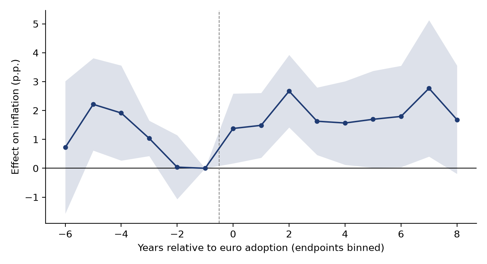
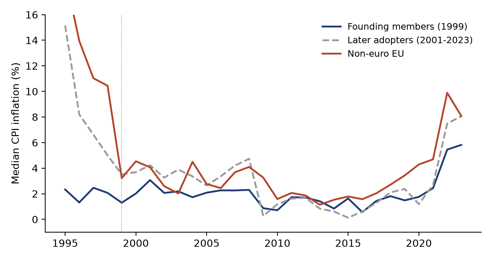

# Does Joining the Euro Reduce Inflation?

**Evidence from a Staggered Difference-in-Differences Design, 1995–2023**

*November 2026*

📄 **[Read the full paper (PDF)](paper.pdf)**

---

## Research question

Joining a monetary union is often defended as a way to *import credibility*: by handing monetary policy
to the European Central Bank, a country with a weak inflation record "ties its hands" (Giavazzi & Pagano, 1988).
This project tests that claim empirically for the 20 countries that adopted the euro between 1999 and 2023.

## Key findings

- **No evidence that the euro reduced inflation.** No specification yields a negative effect.
- A conventional **two-way fixed effects** model even suggests inflation rose by **+2.4 p.p.**
  (p = 0.03; wild cluster bootstrap p = 0.04).
- That estimate is **fragile**. It drops to zero when the sample starts in 2000 (−0.14, p = 0.84) and is
  essentially zero for Western European countries (−0.01, p = 0.98).
- The **event study** reveals a V-shape: countries **disinflate just before joining** (to meet the Maastricht
  criteria) and return to their earlier inflation path afterwards. Parallel pre-trends are rejected (p < 0.001).



*Effect on inflation relative to the year before adoption. Later adopters vs never-treated EU countries, 95% CIs.*

## Data & method

| | |
|---|---|
| **Sample** | 28 current and former EU members, 1995–2023 (812 country-years) |
| **Treatment** | Euro adoption, staggered across 10 cohorts (1999 → 2023) |
| **Controls** | Sweden, Denmark, UK, Poland, Czech Republic, Hungary, Romania, Bulgaria |
| **Outcome** | Annual CPI inflation (World Bank WDI, `FP.CPI.TOTL.ZG`) and distance from the 2% target |
| **Estimators** | Two-way fixed effects; event study with clean (never-treated) controls |
| **Inference** | Country-clustered standard errors + wild cluster bootstrap (Cameron, Gelbach & Miller, 2008) |
| **Robustness** | Winsorizing, sample start, cohort exclusion, transition vs non-transition, country trends |

The design accounts for recent work showing that TWFE can be biased with staggered treatment timing
(Goodman-Bacon, 2021; de Chaisemartin & D'Haultfœuille, 2020; Sun & Abraham, 2021; Callaway & Sant'Anna, 2021).



## Repository structure

```
├── paper.pdf               ← the paper (built automatically)
├── analysis.py             ← downloads the data, runs every model, writes tables & figures
├── .github/workflows/      ← GitHub Actions: rebuilds results and PDF on every push
├── data/
│   ├── raw/                ← World Bank series (CPI inflation, GDP, population)
│   └── panel.csv           ← cleaned analysis panel
└── paper/
    ├── paper.tex           ← LaTeX source
    ├── tables/             ← auto-generated regression tables
    └── figures/            ← auto-generated figures
```

## Replicate

```bash
pip install -r requirements.txt
python analysis.py                              # every number in the paper
cd paper && pdflatex paper.tex && pdflatex paper.tex
```

## Data source

World Bank, *World Development Indicators*, retrieved via the open
[datasets](https://github.com/datasets) mirrors on GitHub (inflation, GDP, population).
