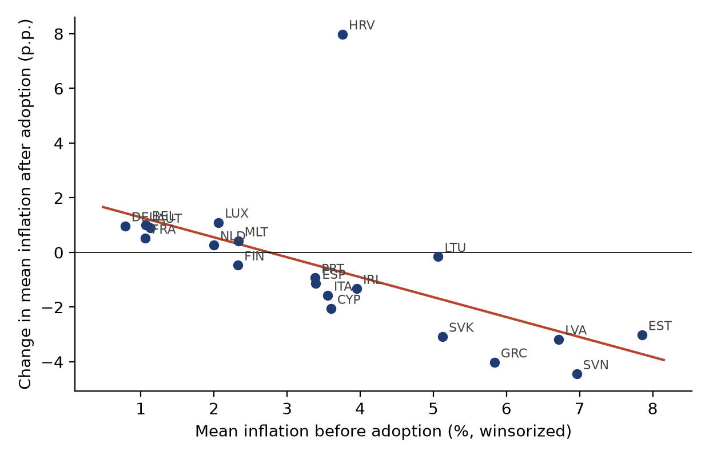
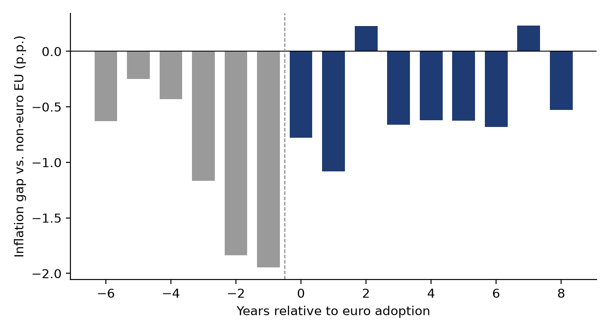

# Does Joining the Euro Reduce Inflation?

**Theory and Panel Evidence from 28 European Countries, 1995–2023**

*Independent research project in international monetary economics · November 2026*

📄 **[Read the full paper (PDF, 21 pages)](paper.pdf)**

---

## Research question

Joining a monetary union is often defended as a way to *import credibility*: by handing monetary policy
to the European Central Bank, a country with a weak inflation record "ties its hands" (Giavazzi & Pagano, 1988).
This project derives the testable implications of that argument and tests them for the 20 countries that
adopted the euro between 1999 and 2023.

## Theory

- **Barro–Gordon credibility model.** Under discretion, inflation carries a bias of λαk. Delegating policy to a
  more inflation-averse union central bank lowers it. The model predicts that the change in inflation after
  adoption falls **one-for-one** with pre-adoption inflation.
- **Balassa–Samuelson model.** In catching-up economies, faster productivity growth in tradables raises
  non-tradable prices. Inside a monetary union this real appreciation must show up as **higher inflation**.

## Key findings

| Estimator | Effect of euro adoption on inflation |
|---|---|
| Pooled OLS | −2.54 p.p. *** |
| Country fixed effects | −1.33 p.p. *** |
| **Two-way fixed effects** (country + year) | **+2.41 p.p.** ** |
| TWFE + country-specific trends | +3.02 p.p. *** |

- Without year effects the euro *seems* to lower inflation, but the regression confuses the general
  disinflation of the late 1990s with an effect of the euro. **With year effects, the sign reverses.**
- The positive estimate is fragile: it is ≈ 0 from 2000 onwards (−0.14, p = 0.84) and for Western Europe (−0.01).
- Countries with high initial inflation did see large declines after adoption (slope −0.73, t = −7.1),
  but a **placebo test** shows the same decline among countries that never adopted the euro.
- Candidates temporarily push inflation down just before joining to meet the Maastricht criterion.

**Conclusion:** no robust evidence that the euro reduced inflation. The observed decline reflects common
disinflation and mean reversion, and higher post-adoption inflation in catching-up economies fits Balassa–Samuelson.





## Data & methods

| | |
|---|---|
| **Sample** | Balanced panel: 28 current and former EU members × 29 years = 812 observations |
| **Treatment** | Euro adoption, 20 countries in nine cohorts (1999 → 2023) |
| **Controls** | Sweden, Denmark, UK, Poland, Czech Republic, Hungary, Romania, Bulgaria |
| **Outcome** | Annual CPI inflation (World Bank WDI, `FP.CPI.TOTL.ZG`) and distance from the 2% target |
| **Estimators** | Pooled OLS, one-way and two-way fixed effects, country-specific trends, cross-sectional OLS with placebo |
| **Inference** | Cluster-robust standard errors by country; HC1 robust errors in the cross-section |
| **Robustness** | Winsorizing, sample period, cohort exclusion, transition vs non-transition, alternative outcome |


## Repository structure

```
├── paper.pdf               ← the paper (built automatically)
├── analysis.py             ← downloads the data, runs every model, writes tables & figures
├── .github/workflows/      ← GitHub Actions: rebuilds results and PDF on every push
├── data/
│   ├── raw/                ← World Bank series (CPI inflation, GDP, population)
│   └── panel.csv           ← cleaned analysis panel
└── paper/
    ├── paper.tex           ← LaTeX source
    ├── tables/             ← auto-generated regression tables
    └── figures/            ← auto-generated figures
```

## Replicate

```bash
pip install -r requirements.txt
python analysis.py                              # every number in the paper
cd paper && pdflatex paper.tex && pdflatex paper.tex
```

## Data source

World Bank, *World Development Indicators*, retrieved via the open
[datasets](https://github.com/datasets) mirrors on GitHub (inflation, GDP, population).
